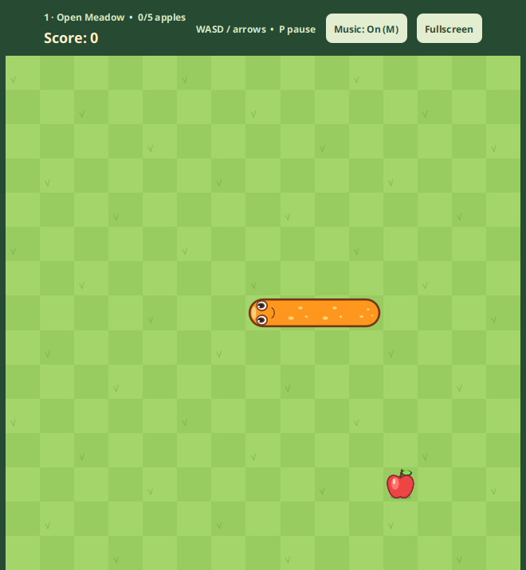
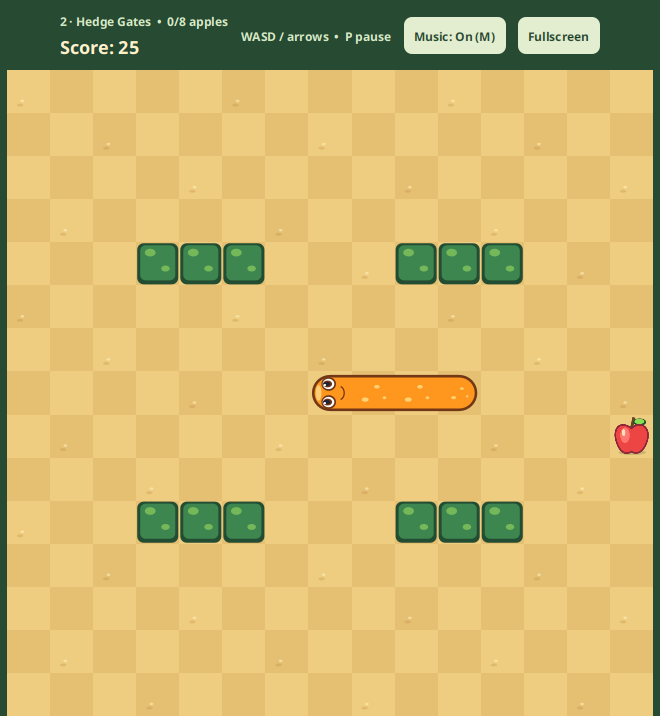
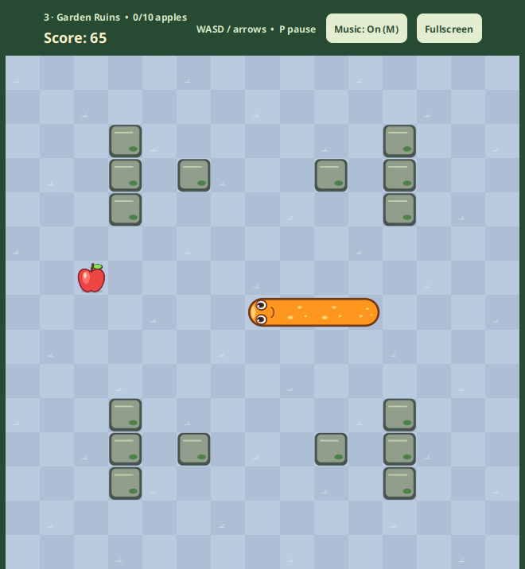

# Gentler ruins, distinct scenery and background music

## Gameplay changes

Garden Ruins was too demanding in the earlier version. The revision lowers its target from 12 to 10 apples, its speed from 10.5 to 9 steps/second, and its obstacle count from 24 to 16. A five-row horizontal corridor and three-column vertical lane provide room to turn and recover. The level still has obstacles and remains slightly faster than Hedge Gates (8.5 steps/second).

The complete adventure now needs 23 apples and awards 115 points. Other goals and scoring rules are unchanged. Historical leaderboard entries are retained rather than erased or rescaled.

## Backgrounds

`BoardBackground` is a presentation-only renderer:

- Meadow: sunny green grass with sparse tufts.
- Hedge Gates: warm autumn orchard colours with leaf details.
- Garden Ruins: cool blue courtyard paving with subtle stone markings.

Decorations do not collide with the snake. Real obstacles remain strongly outlined and the apple remains red. Details are deterministic, so they do not flicker between game ticks. Resizing preserves the grid and its square cells.

## Music and controls

Music begins quietly when the app opens. Click Music in the menu/HUD or press M to mute/unmute. Both buttons observe the same service, so their state remains synchronized when entering games, changing levels and returning to the menu. The track remains independent of the movement timer: pausing the snake does not restart or create another music player. The mute setting lasts for this running app session.

The music is a 19.2-second, mono, 44.1kHz, 16-bit PCM WAV loop bundled at `src/main/resources/resources/audio/meadow-loop.wav`. It is generated by `tools/generate_music.py` without external recordings or samples. To regenerate it, run `python3 tools/generate_music.py`; Python is not a runtime/build requirement because the WAV is already bundled. Notes extending across the loop boundary are wrapped during synthesis, and note envelopes prevent abrupt cuts.

`audio.BackgroundMusic` creates at most one backend, loops it indefinitely at 18% player volume, pauses/resumes on mute, and disposes it when `Main.stop()` runs. Menu and HUD bindings reflect both mute and backend availability. If native media initialization or playback fails, the game continues and the button displays Music unavailable. A failed player is disposed rather than repeatedly initialized.

The service accepts an `AudioLoop` factory so its lifecycle can be tested with a fake backend and no speakers. `Main`/`ViewManager` also accept a music service for integration testing. The normal public no-argument JavaFX entry point still uses the real MediaPlayer backend.

## Verification

- Clean Maven build: 89 JUnit cases, no failures/errors/skips.
- A new corridor test protects the wider horizontal/vertical escape lanes and speed cap.
- 11 audio cases verify player reuse, mute/resume, muted startup, observable state, shutdown, initialization/play/pause/disposal failure, null-backend handling, and bundled PCM format/duration.
- Existing level, reachability, scoring, reset, food placement and leaderboard tests remain green.
- A headless UI smoke check completes all three challenges by moving and collecting controlled apples, checks the new 115-point total, obstacle collisions, retry, all five skins and fullscreen, compares background pixels across levels, and tests menu/HUD/M-key mute synchronization with an injected audio backend. The HUD controls and objective text fit without truncation at the default size. Screenshots were inspected.

Actual audible playback and personal difficulty judgement cannot be established by fake-backend/headless checks. On Windows, confirm the tune is audible at a comfortable volume, M and both buttons mute/resume, transitions do not start overlapping tracks, quitting stops playback, and the wider final level feels fair. Also test the silent fallback if audio is unavailable.
