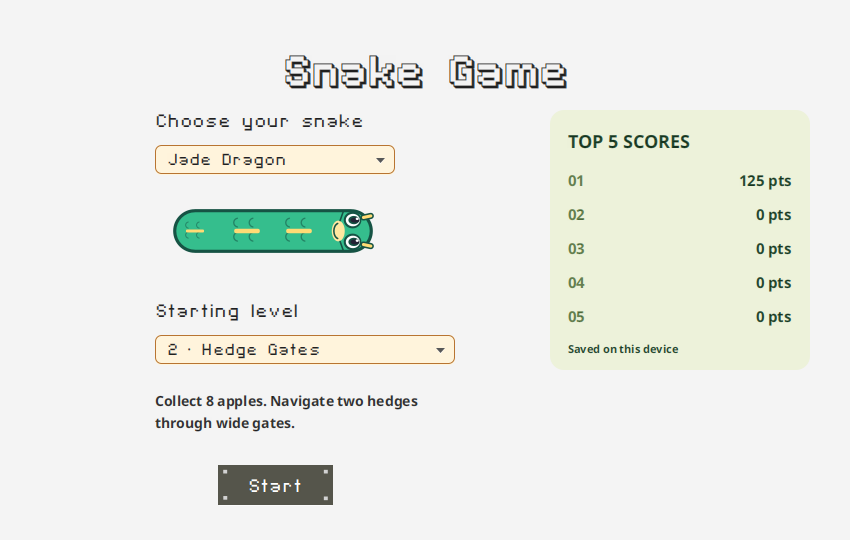
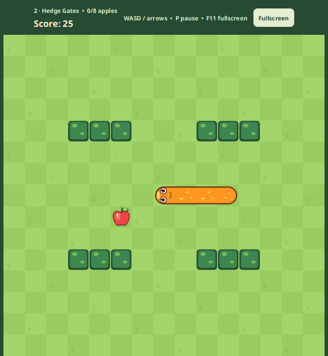
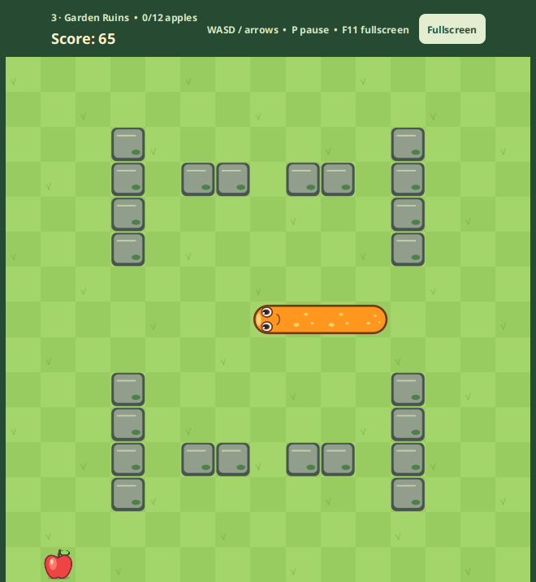
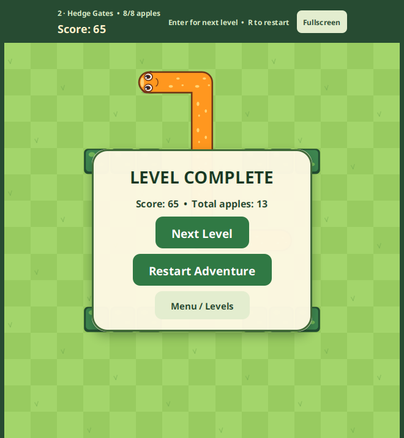

# Three playable challenges

This extension changes how the game is played: players navigate different layouts, collect a level-specific apple target, and progress through faster challenges. It replaces the previous full-board victory objective.

| Level | Goal | Steps/second | Obstacles |
| --- | ---: | ---: | --- |
| Open Meadow | 5 apples | 7 | Open board |
| Hedge Gates | 8 apples | 8.5 | 12 hedge cells with wide gates |
| Garden Ruins | 12 apples | 10.5 | 24 stone cells forming passages |

Choose a skin and starting level in the menu. Starting at Meadow plays the complete adventure; selecting a later level is a shorter practice route through that challenge and its successors. Obstacles and board boundaries cause a loss on contact.

## Progression and scores

- Collect the current goal; movement pauses automatically on the clear screen.
- Press Enter or Next Level to continue. The new level starts with a four-cell snake, its correct obstacles and speed, and a fresh apple.
- Adventure points carry forward: 25 after Meadow, 65 after Hedges, 125 after Ruins when playing the full sequence. Each apple is worth five points.
- The final clear screen is a victory, with no Next Level button. Enter retries.
- Try Again, R and Tab restart from the originally selected starting level with zero points. This deliberately differs from continuing, which preserves score.
- The leaderboard receives one cumulative score when the player dies or completes the final level. Intermediate clears, unfinished abandonment and retry actions do not submit duplicate/partial entries.
- Existing saved leaderboard entries are retained. Older full-board scores were produced under different rules; they are not rescaled or erased.

## Design and maintenance

`model.Level` holds fixed goals, speed and layout definitions. It returns fresh positions for each board. Every layout leaves the starting snake and a three-row horizontal corridor clear; flood-fill tests establish that all non-obstacle cells are reachable from spawn on supported boards. Layouts require at least 15 × 15 cells. This checks static connectivity, not that every possible snake route avoids trapping itself.

`model.LevelProgress` owns level transitions and scoring without JavaFX. It prevents advancing before reaching a goal and prevents extra food collections after completion. `Game` delegates these rules instead of maintaining duplicated score/threshold state. It no longer imports JavaFX. This is a small explicit state model; no design pattern is claimed solely to satisfy the rubric.

`Obstacle` restores the chosen layout on every restart or transition and returns deep copies of its positions. The old unused random generator could create a cell beyond the board edge; deterministic, validated layouts replace it for this mode.

`model.FoodSpawner` enumerates free cells and chooses one with an injectable `RandomGenerator`. The previous retry loop could run indefinitely on a full board. The new algorithm is bounded by board size and returns an empty result when full. The game's short apple objectives leave ample free space; `Coin` reports an explicit error if called with no free cell, rather than hanging. Food artwork is now loaded lazily when drawn, so placement does not start JavaFX.

`GameController` stops at a completed objective, advances only when requested, and records only final results. Restart and next-level paths share initialization so obstacle restoration, score retention/reset, speed and input direction do not drift apart. `GameView` keeps the selected skin across model resets, displays progress, and draws hedges/stone blocks.

## Verification

Run `bash ./mvnw clean verify`.

32 new JUnit cases extend the existing 45 to **77**:

- `LevelTest` (10): goal/speed/order, uniqueness/bounds, clear spawn corridor, independent layouts, supported dimensions and flood-fill reachability.
- `LevelProgressTest` (9): thresholds, skip prevention, score retention, terminal victory and restoring any selected starting level.
- `FoodSpawnerTest` (7): exclusion of body/head/obstacles in every level, full/nearly-full boards, deterministic randomness and invalid inputs.
- `PlayableLevelsTest` (6): reset, changing speed/layout without losing points, defensive copies and invalid game setup.

The separate headless JavaFX check uses the actual menu and drives movement with controlled apple positions. It completes all three levels, checks the 125-point total, Enter and button transitions, fresh snake/food/layout state, no intermediate leaderboard submissions, no duplicate final submission, obstacle deaths, retry from every selected starting level, all five skins and fullscreen/Esc. Rendered screens were visually inspected. This development smoke check is supplementary and is not counted as a JUnit case.

## Manual acceptance checklist

Not yet completed on native Windows:

1. Start each level directly and confirm the displayed goal/layout matches the table.
2. Play Meadow to five apples; confirm movement stops, then continue with Enter.
3. Observe 25 retained points in Hedges and a higher movement speed.
4. Hit a hedge or stone; Enter should return to the selected starting level, restore obstacles and reset score.
5. Play through the final challenge and check that the cumulative score is saved once.
6. Test WASD/arrows, pause/resume, all skins and fullscreen; close/reopen to check leaderboard persistence.

For Q&A, explain the difference between restarting an adventure and continuing to the next level, why static layout connectivity is tested, and why bounded food selection is safer than retrying random cells forever.
