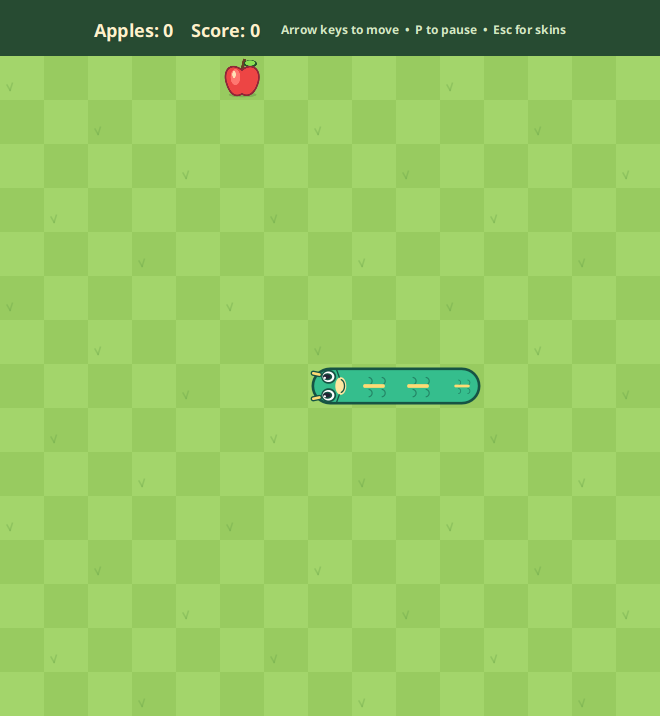
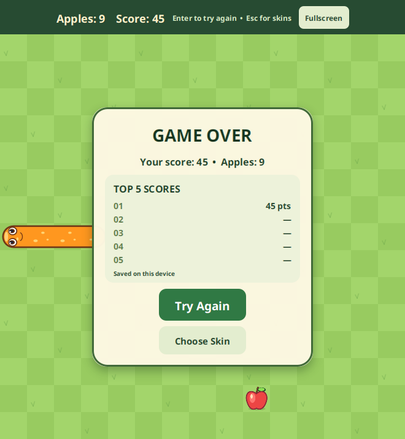
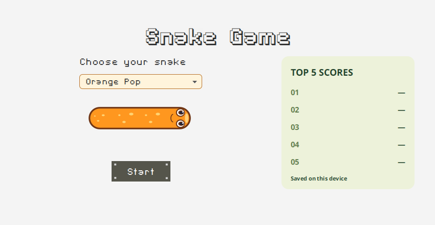

# Snake: Apple Meadow

Choose one of five cartoon skins, then collect red apples on the grass board. The 15 × 15 board uses 44px tiles (previously 20 × 20 with 32px tiles), with a separate score and controls bar. A new snake starts four tiles long. Each apple adds one segment and five points. Food spawns in empty cells, and filling the board wins the round.


- **Orange Pop:** tangerine with golden freckles and large glossy eyes.
- **Mr. Bones:** an ivory skull, turquoise eyes and rounded ribs over a violet body.
- **Cosmic:** purple with mint stars, pink swirls and starry eyes.
- **Candy Pop:** bubblegum pink with mint stripes and cream accents.
- **Jade Dragon:** jade scales, golden markings, rounded horns and whiskers.

The game renders each snake as one connected ribbon, using a single base colour through the head, neck and corners. This avoids tile seams and colour changes when turning. Markings are clipped inside the body at elbows; the eyes and facial details sit directly on its front. Menu previews use the same renderer. The older power-up coins are no longer spawned in this apple-collecting mode.

## Playing and restarting

- WASD or arrow keys start, steer and resume the snake. W moves up, A left, S down and D right. Reversing directly into its neck is blocked.
- P pauses.
- Click **Try Again** after losing or winning. The score, apples and snake reset while keeping your skin.
- Enter restarts after losing or winning. R or Tab also restarts a round.
- Click **Choose Skin**, or press Esc, to return to the menu.
- Click **Fullscreen** or press F11 to toggle fullscreen. Esc exits fullscreen first; press Esc again to return to the menu. Plus and minus also enter and leave fullscreen. The board automatically fits the available space with square tiles when fullscreen, maximized or resized. F11 also works in the skin menu.





## Run without installing Maven

Install JDK 25, then run these commands in the cloned project directory using Git Bash / MSYS2, Linux or macOS:

```sh
git pull
bash ./mvnw javafx:run
```

The wrapper downloads Maven 3.9.9 automatically on its first run and handles Windows line endings in its download configuration. In Windows PowerShell, use `.\mvnw.cmd javafx:run`; `JAVA_HOME` must point to your JDK folder.

The existing JavaFX 25.0.1 dependency needs JDK 23 or later at runtime. JDK 25 is recommended. Run `bash ./mvnw package` to build.

## Validation

The Maven package build passes with JDK 25. Headless JavaFX checks cover all five skins, menu/start-button wiring, apple scoring and growth, turns and reverse-direction rejection, wall collision, the actual Try Again button, preserving the skin after retry, moving after retry, a full-board win without hanging during food spawning, restarting after victory, returning to skin selection, and the 660 × 716 scene with 44px tiles. The artwork, board and loss-screen snapshots were visually inspected. These checks do not replace manual gameplay on Windows.

Fullscreen checks pass for menu and game F11 shortcuts, the fullscreen button, Esc, plus/minus, starting a game from the fullscreen menu, centered square boards at 1920 × 1080, 1280 × 720, 560 × 500 and 660 × 716, and loss/retry and WASD after resizing. These are headless JavaFX checks; native Windows fullscreen has not been manually tested.

## Top five scores

The menu and game-over / victory panel show the five highest scores, ranked from highest to lowest. Each completed round is recorded once, including tied scores. Retrying or returning to the menu does not submit the same round again; restarting or leaving an unfinished round does not submit it. The latest round's score and apple count appear above the leaderboard.

Scores persist locally in `data/leaderboard.txt`, relative to the directory used to launch the game. This folder is excluded from Git. This is a leaderboard for this device, rather than an online leaderboard. If the file cannot be saved, the leaderboard remains usable for the current session and displays that status.



Leaderboard checks pass for descending top-five ranking, ties, empty and malformed files, saving and reloading, write-failure fallback, menu and end-screen rendering, fitting a 560 × 500 window, recording losses and wins once, retrying without duplicate submissions, and refreshing the menu after a round.
