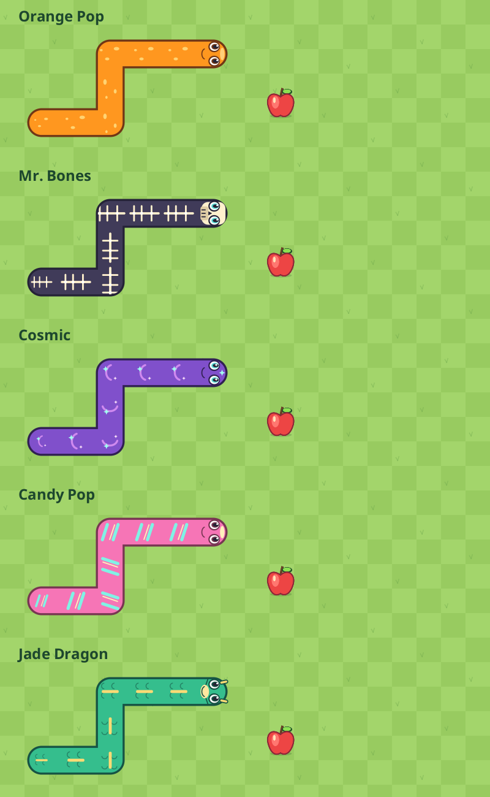

# Snake: Apple Meadow

Choose one of five cartoon skins, then collect red apples on the grass board. The 20 × 20 board now uses 32px tiles (previously 20px), with a separate score and controls bar. A new snake starts four tiles long. Each apple adds one segment and five points. Food spawns in empty cells, and filling the board wins the round.



- **Orange Pop:** tangerine with golden freckles and large glossy eyes.
- **Mr. Bones:** an ivory skull, turquoise eyes and rounded ribs over a violet body.
- **Cosmic:** purple with mint stars, pink swirls and starry eyes.
- **Candy Pop:** bubblegum pink with mint stripes and cream accents.
- **Jade Dragon:** jade scales, golden markings, rounded horns and whiskers.

The game renders each snake as one connected ribbon, using a single base colour through the head, neck and corners. This avoids tile seams and colour changes when turning. Markings are clipped inside the body at elbows; the eyes and facial details sit directly on its front. Menu previews use the same renderer. The older power-up coins are no longer spawned in this apple-collecting mode.

## Playing and restarting

- Arrow keys start, steer and resume the snake. Reversing directly into its neck is blocked.
- P pauses.
- Click **Try Again** after losing or winning. The score, apples and snake reset while keeping your skin.
- R or Tab also restarts a round.
- Click **Choose Skin**, or press Esc, to return to the menu.
- Plus and minus enter and leave fullscreen.


## Run without installing Maven

Install JDK 25, then run these commands in the cloned project directory using Git Bash / MSYS2, Linux or macOS:

```sh
git pull
bash ./mvnw javafx:run
```

The wrapper downloads Maven 3.9.9 automatically on its first run and handles Windows line endings in its download configuration. In Windows PowerShell, use `.\mvnw.cmd javafx:run`; `JAVA_HOME` must point to your JDK folder.

The existing JavaFX 25.0.1 dependency needs JDK 23 or later at runtime. JDK 25 is recommended. Run `bash ./mvnw package` to build.

## Validation

The Maven package build passes with JDK 25. Headless JavaFX checks cover all five skins, menu/start-button wiring, apple scoring and growth, turns and reverse-direction rejection, wall collision, the actual Try Again button, preserving the skin after retry, moving after retry, a full-board win without hanging during food spawning, restarting after victory, returning to skin selection, and the 640 × 696 scene with 32px tiles. The artwork, board and loss-screen snapshots were visually inspected. These checks do not replace manual gameplay on Windows.
